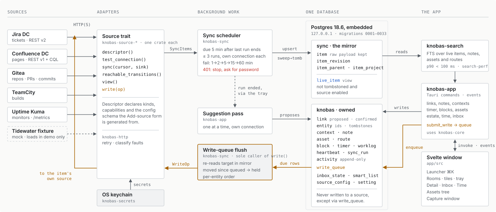
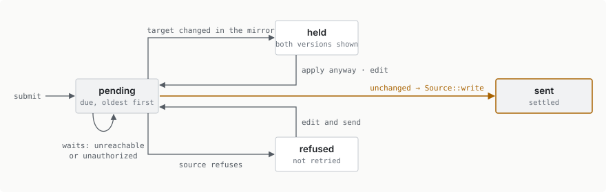
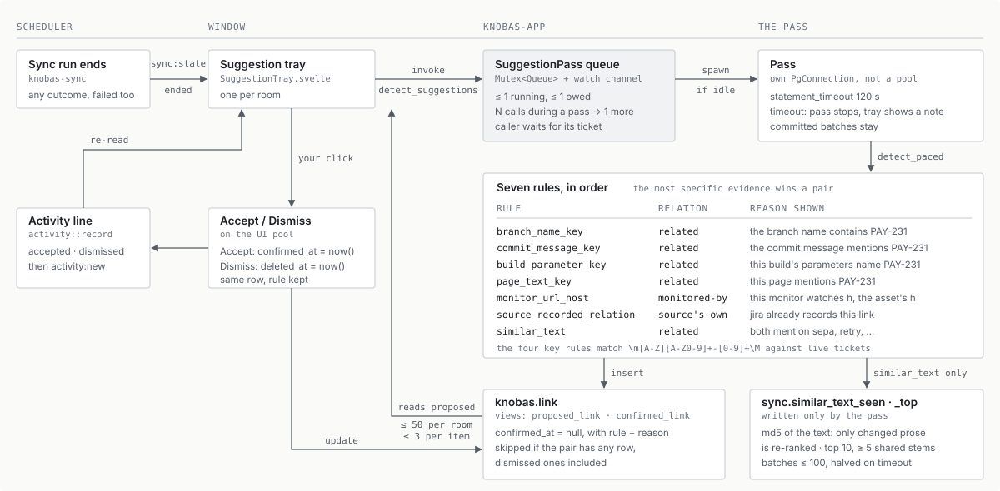

This is a toy project just to see how far agents can go with minimal supervision!


# knobas

knobas is a personal work cockpit. It is a desktop app (Rust, Tauri 2, Svelte 5)
that syncs Jira, Confluence, Gitea, TeamCity and Uptime Kuma into one embedded
Postgres and searches all of them from one box. On top of that mirror it keeps
what no single source owns: links, notes, contexts, an inbox, assets and time
tracking that turns into worklogs.

**Status:** every planned milestone, M0 through v1.5, is closed. `v3.2.6` is
the latest release (2026-10-27), and the manifests carry `3.2.6`.
Ongoing work is tracked in [GitHub Issues](https://github.com/BFoerschner/knobas/issues).

## How it works

Read the map left to right for sync and right to left for write-back. Grey
arrows carry data in. The amber path is the only route that changes anything at
a source. Every write goes through `knobas.write_queue`, and the flush loop is
the only code that calls `Source::write`. A second call site fails
`crates/knobas-sync/tests/it/write_choke_point.rs`.

<picture>
  <source media="(prefers-color-scheme: dark)" srcset="docs/diagrams/system-map-dark.svg">
  
</picture>

`submit_write` stores the write and returns at once. Before sending, the flush
loop compares the mirror's copy of the target with the snapshot taken when the
write was queued. A held or refused write waits for a person. Nothing times
out or applies itself.

<picture>
  <source media="(prefers-color-scheme: dark)" srcset="docs/diagrams/write-queue-dark.svg">
  
</picture>

The suggestion pass proposes links and never confirms one. The sync scheduler
requests a pass whenever a sync run ends OK, and does not wait for it. Each pass
runs on its own connection, and requests that arrive during a pass share the
next one.

<picture>
  <source media="(prefers-color-scheme: dark)" srcset="docs/diagrams/suggestion-pass-dark.svg">
  
</picture>

The diagrams are hand-written SVG, one file per theme, checked against the code
at `3c3bb715`. Nothing regenerates them, so update both themes when the code
they show changes.

## Quickstart

You need [rustup](https://rustup.rs) (`rust-toolchain.toml` pins Rust 1.99),
Node 20.19+ or 22.12+ (Vite 8's requirement) and
[`just`](https://github.com/casey/just).

```bash
just deps     # npm ci in app/
just check    # the full quality gate
just dev      # the app, default profile
just demo     # the app, demo profile, where the sample data loads
```

The first `just dev` or test run downloads PostgreSQL 18.6 once and needs
network. [docs/development.md](docs/development.md) covers the gate, profiles,
releases, the crates and the frontend rules.

## Documents

- Design spec: `docs/specs/2026-08-23-knobas-design.md`
- Glossary: `CONTEXT.md`
- Architecture decisions: `docs/adr/`; dated rulings: `docs/decisions/`
- Roadmap: `docs/roadmap.md`
- Frozen contracts (`Source` trait, migrations, IPC): `docs/contract.md`
- Test environment and live suites: `testenv/README.md`
- Agent workflow: `docs/agents/`
- UI mockups: `mockups/`
