# knobas

This is a toy project just to see how far agents can go with minimal supervision!

knobas is a personal work cockpit. It is a desktop app that syncs Jira, Confluence, Gitea, TeamCity and Uptime Kuma into one Postgres on your own machine, searches all of them from one box, and ties what it finds to the ticket you are working on.

[Download the latest release](https://github.com/BFoerschner/knobas/releases/latest) for macOS, Windows or Linux, [try the interface in a browser](#try-it-in-a-browser), or [build it from source](#build-it-from-source).

<picture>
  <source media="(prefers-color-scheme: dark)" srcset="docs/screenshots/job-dark.webp">
  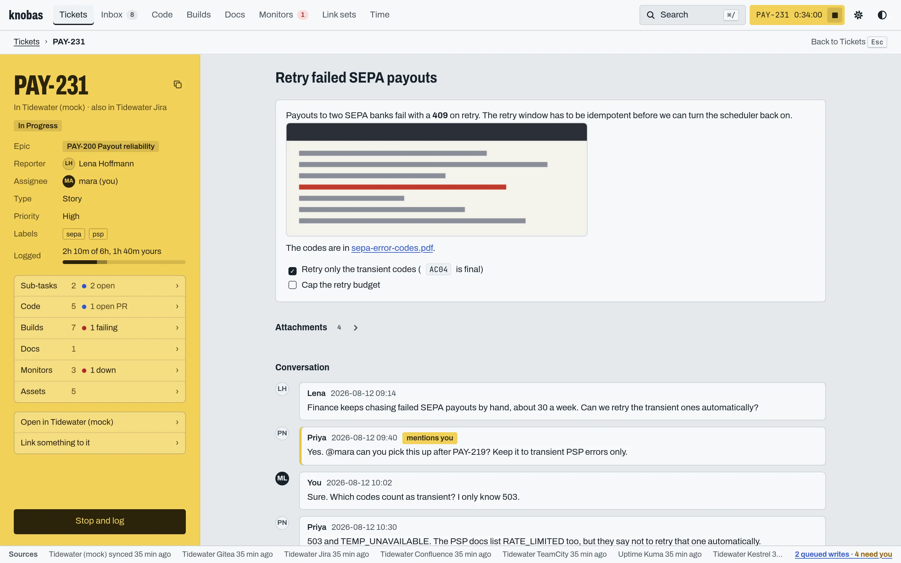
</picture>

<sub>Every picture on this page is the app's real interface on made-up data, from a fictional company called Tidewater. Each release redraws them. These are from <!-- shots-version -->main<!-- /shots-version -->.</sub>

## The ticket you are on is the home page

Choose a ticket and it becomes your job, and its card turns yellow. The card counts what surrounds the ticket, sub-tasks, code, builds, docs and monitors, and each row shows its worst state, so a failing build is visible before you open anything. The description, attachments and whole conversation sit beside it. The timer runs from the foot of the card, and from the top bar on every other page.

A link set fills in what a ticket does not name itself. Name the repositories, pipelines, pages and monitors once, and they show on every ticket under an epic or in a project, with nothing copied onto the tickets or written to Jira.

## One box searches everything

⌘K opens the launcher. It searches the local copy of every source, so the answer does not wait on a server, and it finds every kind you have, down to your saved views and link sets. `#t` narrows to tickets, and every other kind has a letter too. Tab opens a row's actions, like linking it to your job. ⌘S keeps a query as a list you can come back to.

<picture>
  <source media="(prefers-color-scheme: dark)" srcset="docs/screenshots/launcher-dark.webp">
  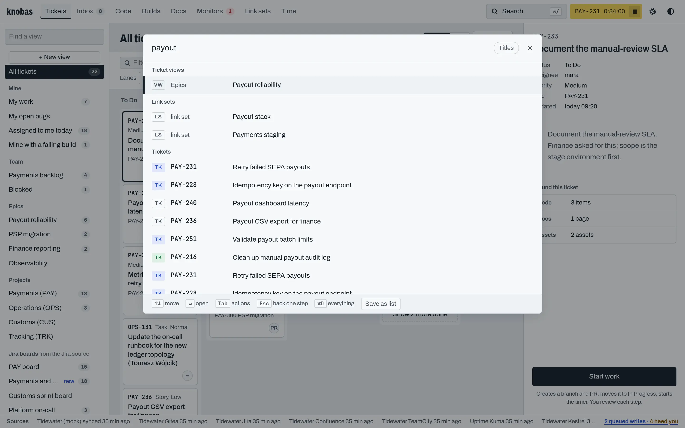
</picture>

## One inbox for everything that asks for you

Review requests, mentions, failed builds, assignments, monitors that went down and rejected sign-ins land in one stream, newest first. Each row says which job it belongs to and carries its own next step, whether that is Review, Re-run or Ack, beside Snooze and Done.

<picture>
  <source media="(prefers-color-scheme: dark)" srcset="docs/screenshots/inbox-dark.webp">
  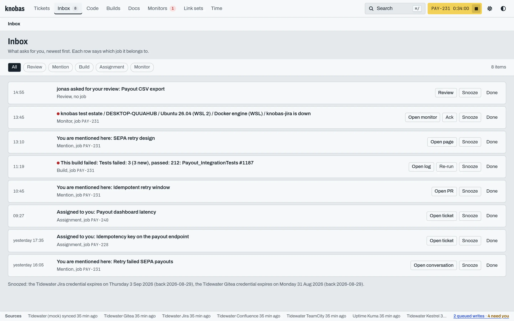
</picture>

## Every ticket system on one board

Tickets reads every ticket system you connect. Saved views run down the left: your work, your team's, each epic and project, and your Jira boards as Jira defines them. *Start work* on a ticket creates the branch and pull request, moves it to In Progress and starts the timer, and you review each step.

<picture>
  <source media="(prefers-color-scheme: dark)" srcset="docs/screenshots/tickets-dark.webp">
  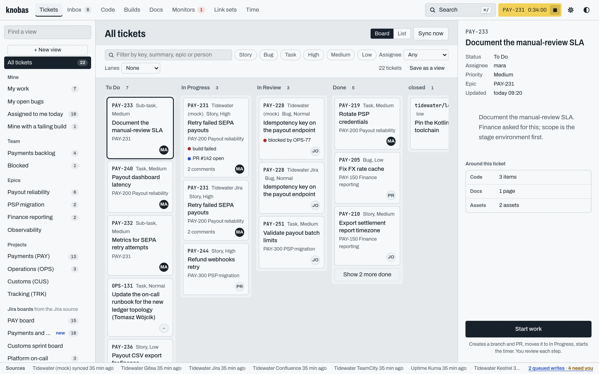
</picture>

## Review code in the same window

Repositories, branches, commits and pull requests come from Gitea or Forgejo. Every diff uses one view: split or unified, word-level marks, expandable context, a file tree and a *since my last review* range. Draft comments survive a restart, and the keyboard covers it, with `j` and `k` for files, `n` and `p` for hunks and `c` for a comment.

<picture>
  <source media="(prefers-color-scheme: dark)" srcset="docs/screenshots/pull-request-dark.webp">
  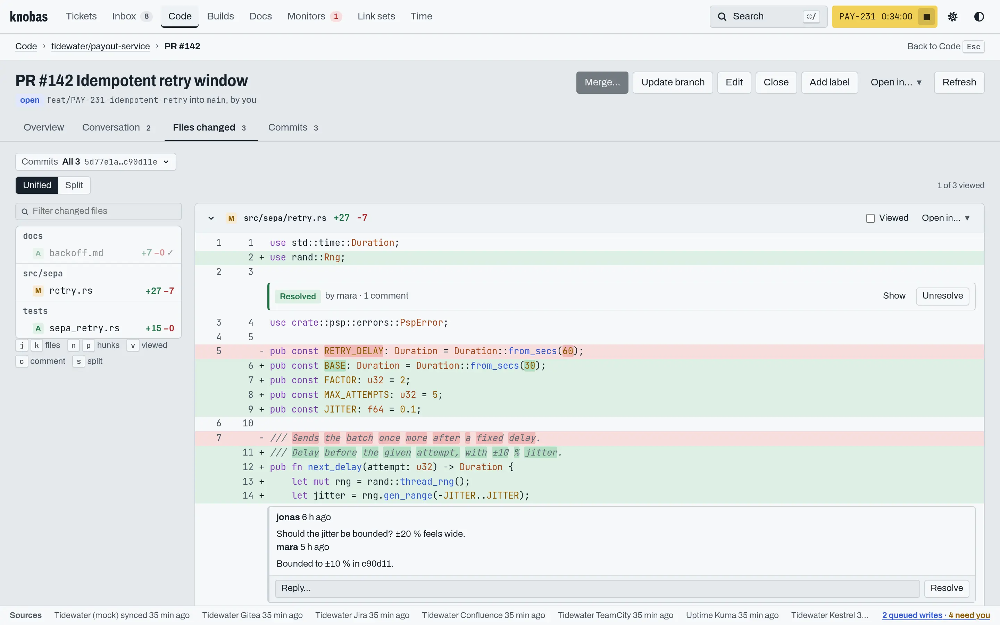
</picture>

Files draw as what they are. Markdown, Mermaid, D2, Graphviz, PDF and images each have a renderer, code gets syntax highlighting, and you can add your own command as a renderer.

<picture>
  <source media="(prefers-color-scheme: dark)" srcset="docs/screenshots/file-dark.webp">
  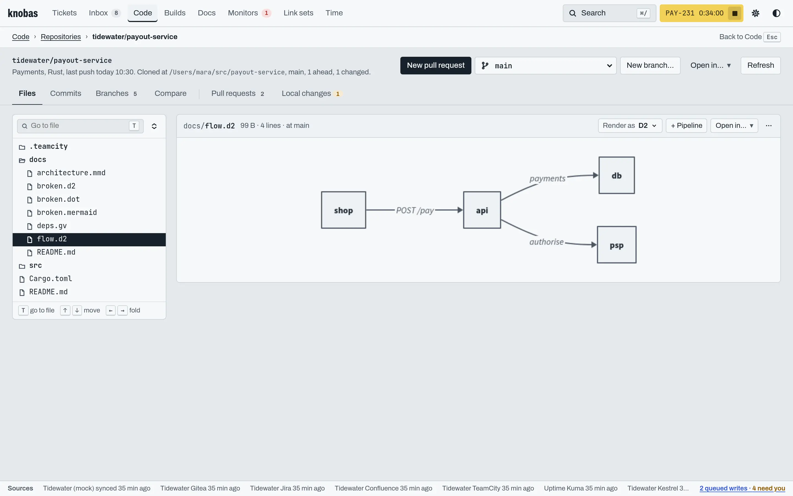
</picture>

## Builds that say what broke

A TeamCity run opens on the failure: the failed test, its assertion, whether it already failed on this branch and whether `main` passed. The bar on top shows where the time went. Re-run it, run it again with changes, or jump to the line in the log or the test file from the same page.

<picture>
  <source media="(prefers-color-scheme: dark)" srcset="docs/screenshots/build-dark.webp">
  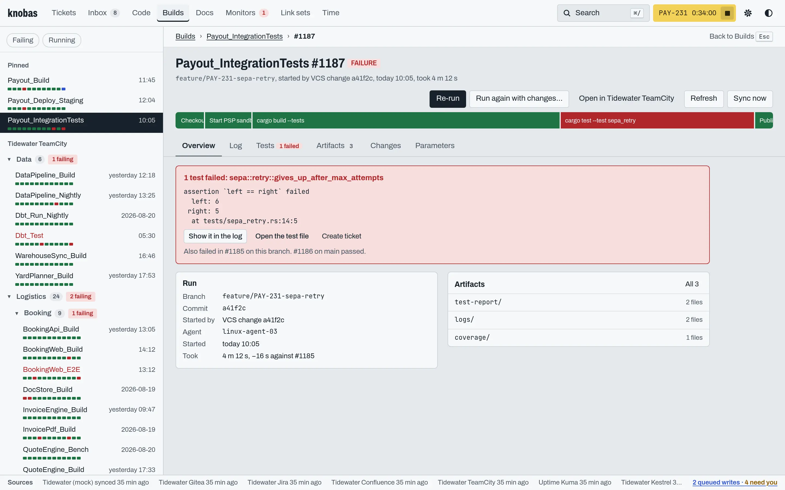
</picture>

## Confluence pages, drawn whole

Docs draws Confluence pages in the app, with their embeds, includes, task lists, expands and tables, beside a tree of the space. Pages that mention you come first, a page that tracks a ticket shows that ticket's status in line, and you can write pages from here too.

<picture>
  <source media="(prefers-color-scheme: dark)" srcset="docs/screenshots/docs-dark.webp">
  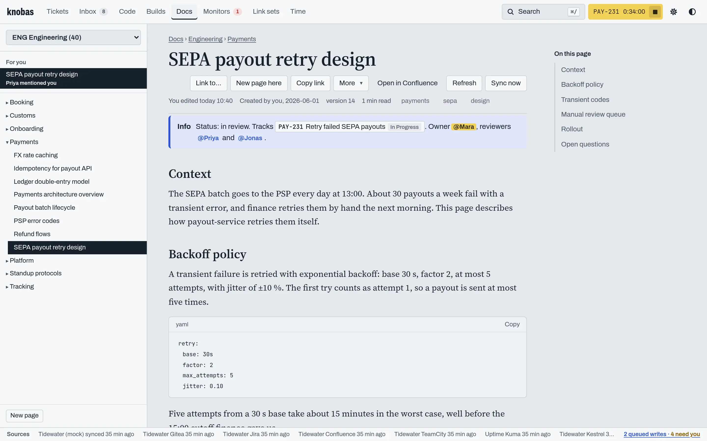
</picture>

## Every check and its last 24 hours

Uptime Kuma's checks sit in one table, each with a 24-hour bar in half-hour segments. knobas samples them itself, because Kuma prunes raw heartbeats after about a day. Acknowledge an alert or pause a check from its row.

<picture>
  <source media="(prefers-color-scheme: dark)" srcset="docs/screenshots/monitors-dark.webp">
  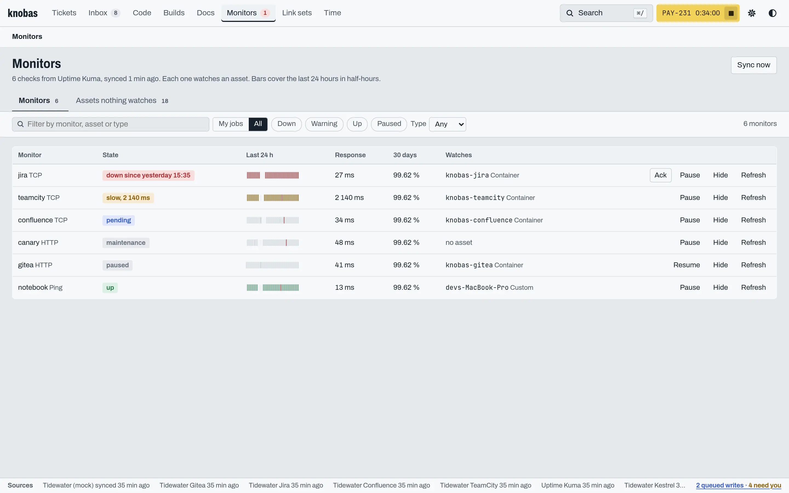
</picture>

## Time that becomes worklogs

Start the timer on a ticket and your day fills in on a strip. knobas also notes what was in front of you and offers those stretches as blocks, which you add to a ticket or dismiss. The day page says what is tracked, what is logged and what is still owed to Jira, and *Log all* sends the rest.

<picture>
  <source media="(prefers-color-scheme: dark)" srcset="docs/screenshots/time-dark.webp">
  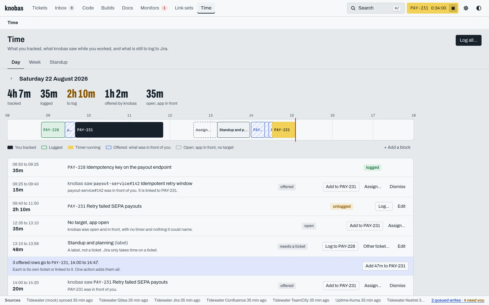
</picture>

## A standup that is already drafted

The digest comes from what knobas saw since your last working day: what you did yesterday, what runs today, blockers and infrastructure trouble. Copy it as text, or take the team's notes beside it and publish the protocol to Confluence.

<picture>
  <source media="(prefers-color-scheme: dark)" srcset="docs/screenshots/standup-dark.webp">
  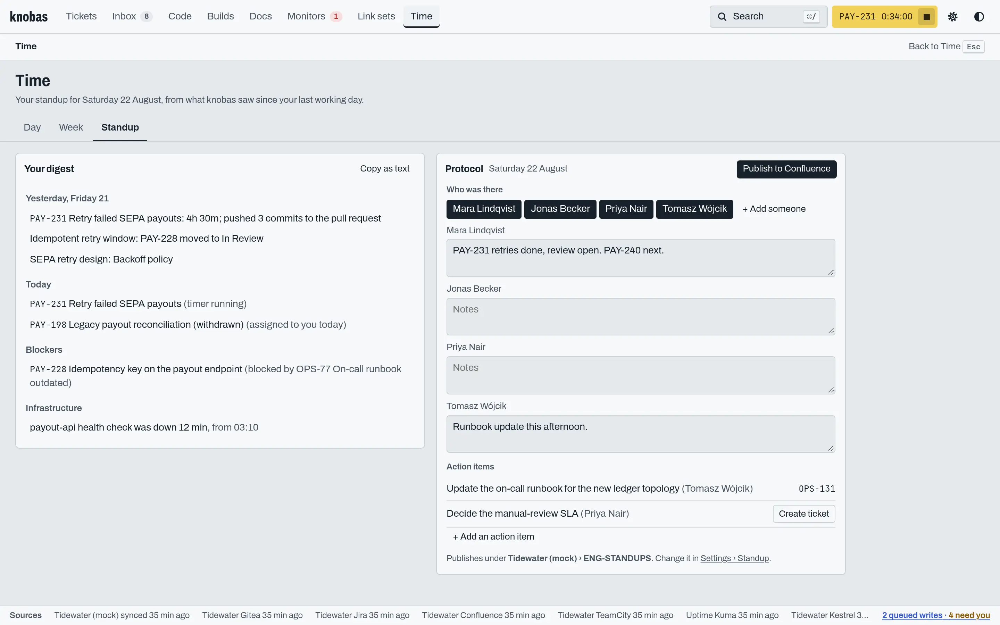
</picture>

## Bring your own source

Jira and Confluence Data Center, Gitea and Forgejo, TeamCity and Uptime Kuma have built-in adapters. Anything else can be an external adapter, a WebAssembly component installed from a GitHub release. It runs under wasmtime with a deadline and memory cap on every call, gets no disk, never sees the credential and can only reach the hosts its manifest declares. knobas shows you those hosts at install and never updates an adapter on its own. [`knobas-adapter-sdk`](crates/knobas-adapter-sdk) is the Rust SDK, and [ADR-0028](docs/adr/0028-an-external-adapter-is-a-sandboxed-wasm-component-installed-from-a-release.md) has the reasoning.

<picture>
  <source media="(prefers-color-scheme: dark)" srcset="docs/screenshots/sources-dark.webp">
  
</picture>

## How it works

Adapters sync each source into one embedded PostgreSQL, and search and the app read that copy. Read the map left to right for sync and right to left for write-back. Grey arrows carry data in. The amber path is the only route that changes anything at a source.

<picture>
  <source media="(prefers-color-scheme: dark)" srcset="docs/diagrams/system-map-dark.svg">
  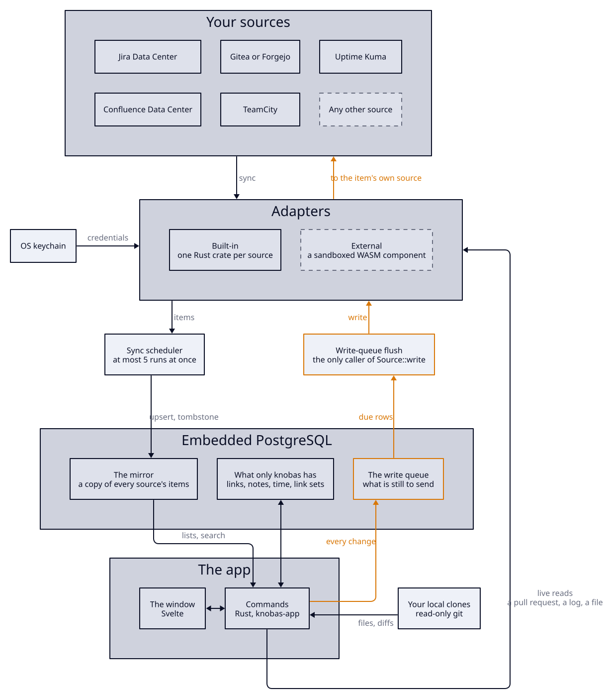
</picture>

Everything you do from knobas takes that path: comments, status changes, worklogs, merges, re-runs and page edits. A write is stored and returns at once, and the flush loop is the only code that calls `Source::write`. Before sending, it compares the mirror's copy of the target with the snapshot taken when the write was queued. A held or refused write waits for a person. Nothing times out or applies itself.

<picture>
  <source media="(prefers-color-scheme: dark)" srcset="docs/diagrams/write-queue-dark.svg">
  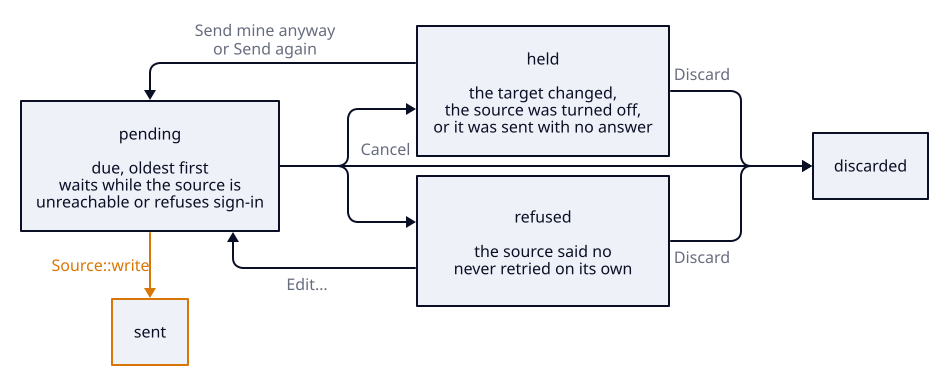
</picture>

Credentials stay in the OS keychain, and none reaches Postgres or crosses into the webview.

## Get it

Each [release](https://github.com/BFoerschner/knobas/releases/latest) has a macOS `.dmg` for Apple Silicon, Windows `.exe` and `.msi`, and Linux `.deb`, `.rpm` and `.AppImage` for x86_64. The first run downloads PostgreSQL 18.6 once, so it needs network.

Nothing is signed, so macOS and Windows object. macOS says the app is damaged, which it is not. Clear the quarantine flag:

```bash
xattr -dr com.apple.quarantine /Applications/knobas.app
```

Windows shows SmartScreen. Choose *More info*, then *Run anyway*.

## Try it in a browser

The interface runs in a plain browser on the same made-up data as these pictures, with no Rust and no database. You need Node 20.19+ or 22.12+.

```bash
npm ci --prefix app
npm run dev --prefix app
```

Then open <http://localhost:1420/?fake-ipc>. A reload puts everything back.

## Build it from source

You need [rustup](https://rustup.rs) (`rust-toolchain.toml` pins Rust 1.99), the same Node and [`just`](https://github.com/casey/just).

```bash
just deps     # npm ci in app/
just check    # the full quality gate
just dev      # the app, default profile
just demo     # the app, demo profile, where the sample data loads
```

[docs/development.md](docs/development.md) covers the gate, profiles, releases, the crates and the frontend rules, and how `just readme-shots` makes the pictures on this page.

## Built by agents

Agents wrote knobas, in over 1,100 merged pull requests in its first eleven weeks. Björn makes the decisions in a grilling session that ends in a spec and tickets. A loop then hands each ticket to an implementer agent in its own worktree, and a merge-manager agent reviews it, runs the gate and merges. [The working model](docs/agents/working-model.md) has the rules and the numbers behind them, [`CONTEXT.md`](CONTEXT.md) the vocabulary, and [`docs/adr/`](docs/adr/) the decisions.
