# knobas

Your tickets, code, builds, docs and monitors in one desktop app.

knobas syncs Jira, Confluence, Gitea, TeamCity and Uptime Kuma to your own machine, so everything is one search away and tied to the ticket you are working on.

This is a toy project just to see how far agents can go with minimal supervision!

**[Download](https://github.com/BFoerschner/knobas/releases/latest)** · [Try it in a browser](#try-it-in-a-browser) · [Build it from source](#build-it-from-source) · [How it works](docs/how-it-works.md)

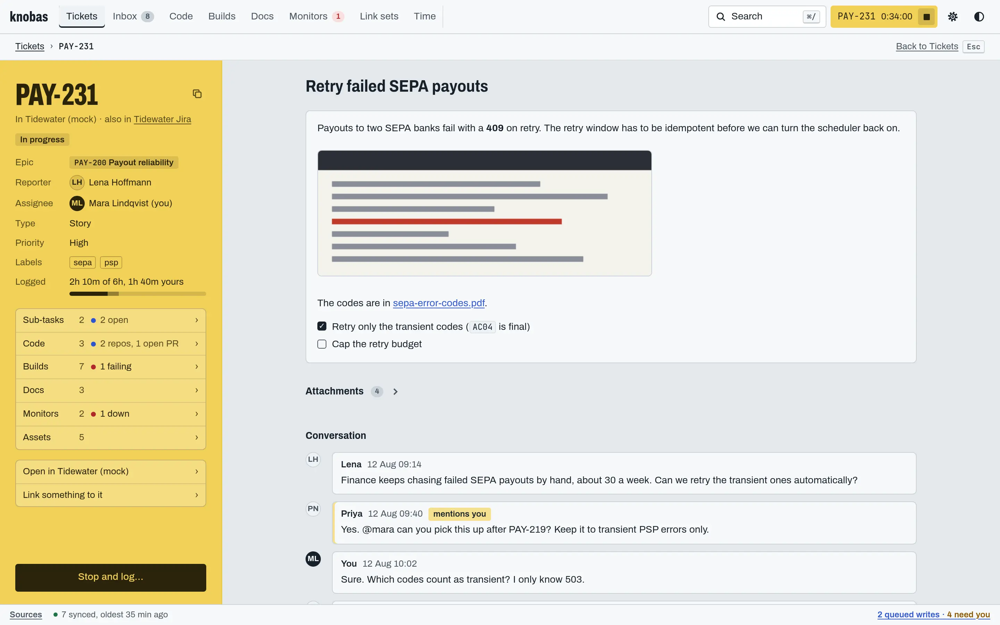

<sub>Made-up data from a fictional company. Each release redraws these pictures. These are from <!-- shots-version -->v3.2.9-ux4<!-- /shots-version -->.</sub>

## Everything about a ticket on one page

Pick a ticket and it becomes your job. Its code, builds, docs and monitors sit on one card, so you see what is failing before you open anything.

## Search everything from one box

Press ⌘K to find tickets, pages, pull requests and more, then act on them from the keyboard.

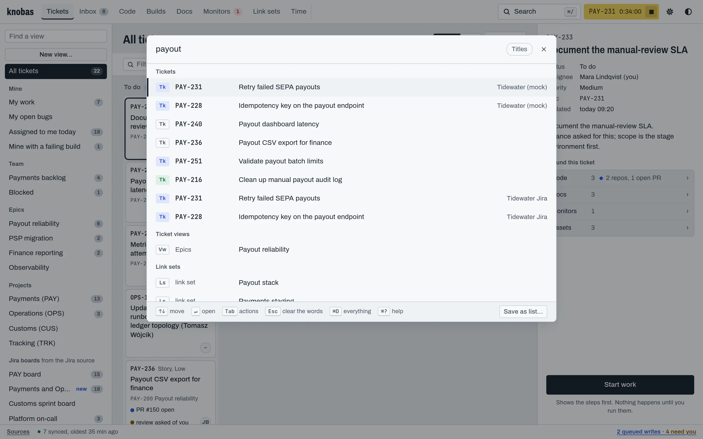

## One inbox for whatever needs you

Review requests, mentions, failed builds and alerts land in one list, each with its next step on the row.

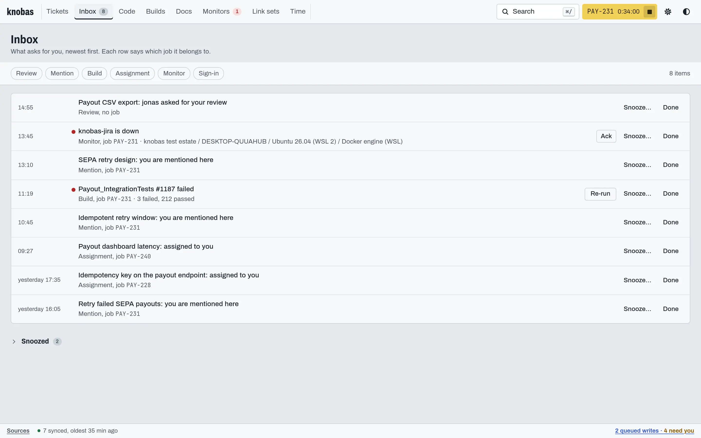

## All your tickets on one board

Every ticket system together, with saved views. *Start work* creates the branch and pull request and starts the timer.

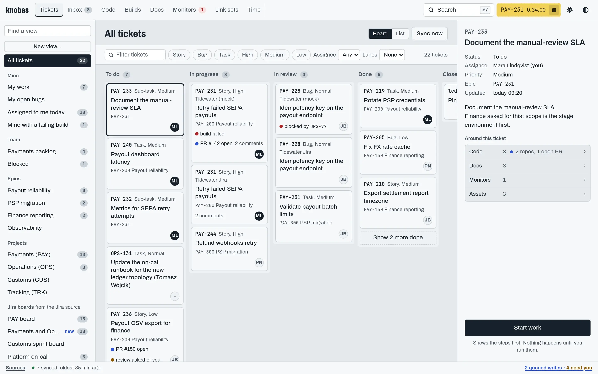

## Review code without leaving

Read diffs, comment and merge from the same window.

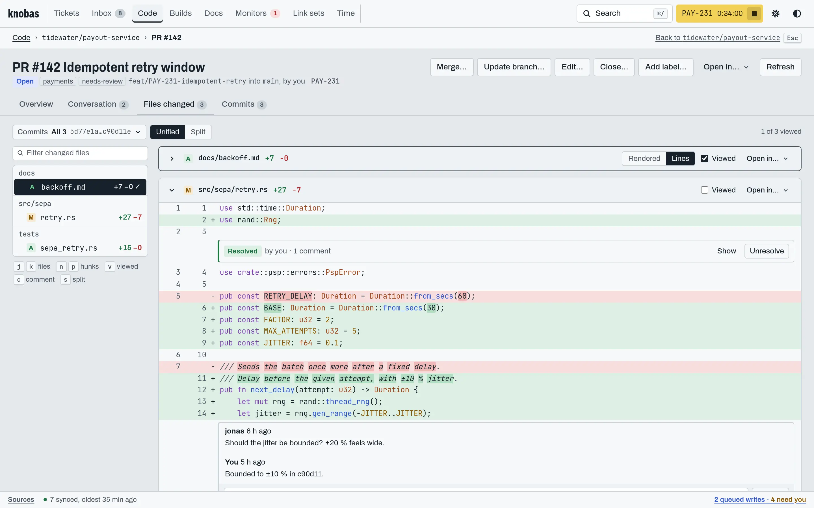

Files draw as what they are: Markdown, diagrams, PDFs and images.


## See why a build failed

A failed run opens on the failing test, and tells you whether it failed before.

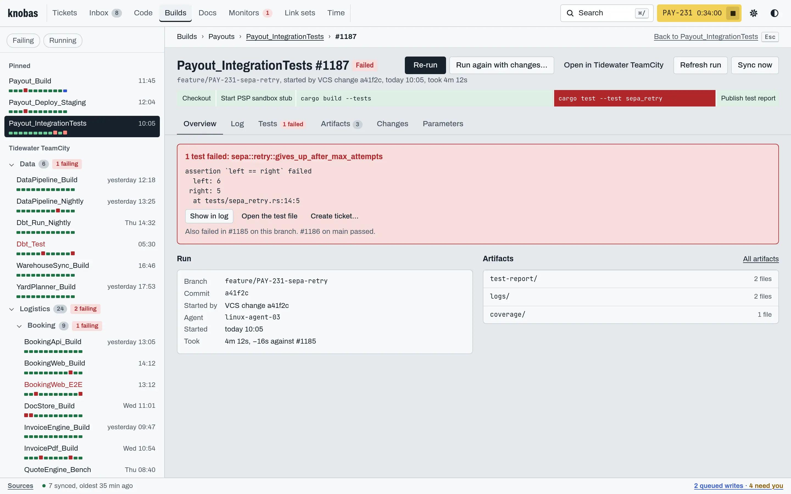

## Confluence pages, drawn in full

Read and write pages here, with the ones that mention you first.

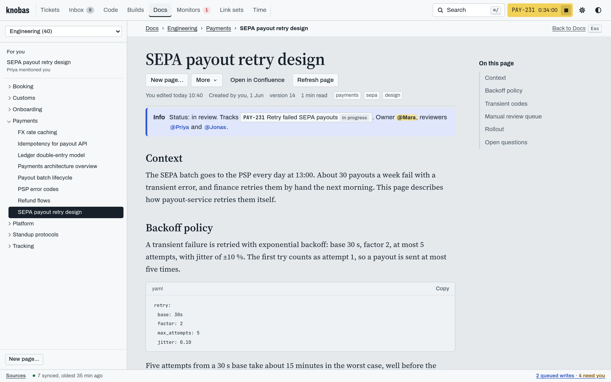

## Every monitor at a glance

All your Uptime Kuma checks with their last 24 hours. Acknowledge or pause one from its row.

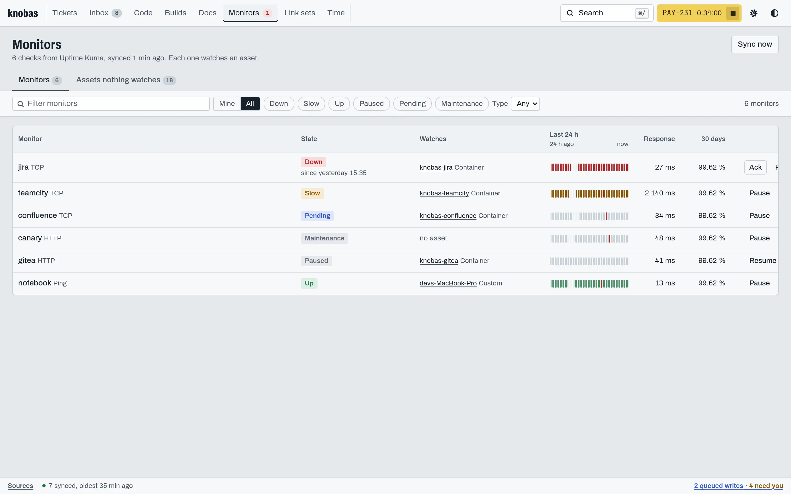

## Time tracking that fills in your worklogs

Run a timer, and knobas offers up what else you worked on. Send it all to Jira when you are done.

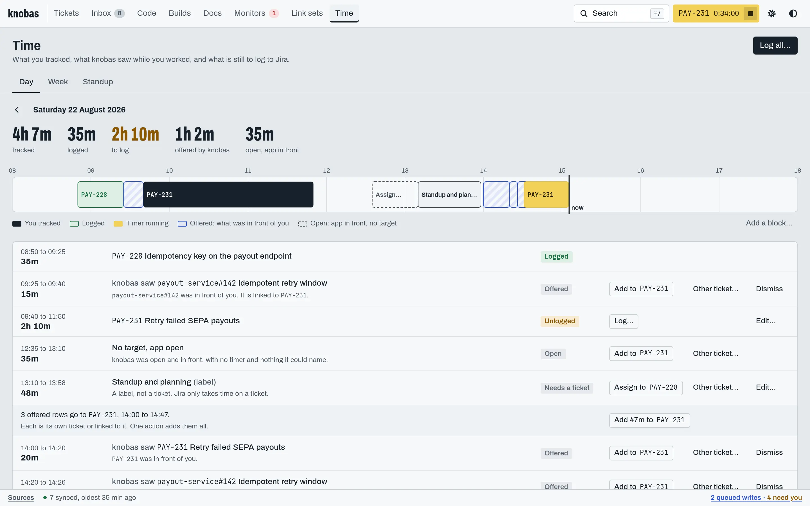

## Your standup, already drafted

Yesterday, today and blockers, ready to copy or publish to Confluence.

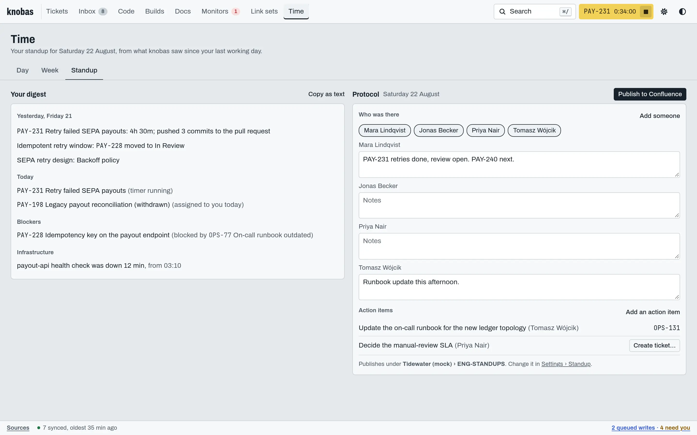

## Bring your own sources

Connect the built-in sources, or install a sandboxed adapter for anything else.

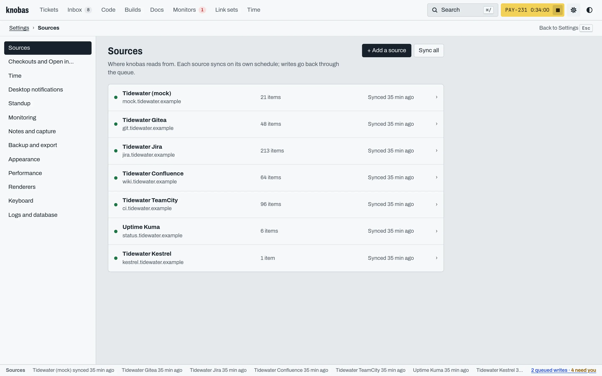

## It stays on your machine

Your data syncs to a database on your computer, and your credentials stay in the OS keychain. Anything you change goes through a queue you can see, and a conflict waits for you to decide. [How it works](docs/how-it-works.md) has the details.

## Get it

[Download the latest release](https://github.com/BFoerschner/knobas/releases/latest) for macOS (Apple Silicon), Windows or Linux. The first launch downloads PostgreSQL once, so it needs network.

Nothing is signed yet, so your system will object. On macOS, run this after installing:

```bash
xattr -dr com.apple.quarantine /Applications/knobas.app
```

On Windows, choose *More info*, then *Run anyway*.

## Try it in a browser

Click around on the same made-up data as these pictures. You only need Node 20.19+ or 22.12+.

```bash
npm ci --prefix app
npm run dev --prefix app
```

Then open <http://localhost:1420/?fake-ipc>.

## Build it from source

You need [rustup](https://rustup.rs), Node and [`just`](https://github.com/casey/just).

```bash
just deps
just dev
```

[docs/development.md](docs/development.md) has everything else.

## Built by agents

Agents wrote knobas, in over 1,100 merged pull requests in its first eleven weeks. Björn makes the decisions, and [the working model](docs/agents/working-model.md) has the rest.
