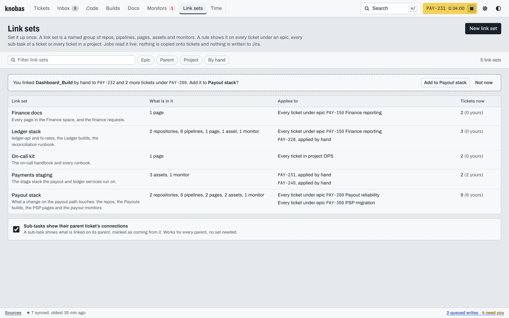

# knobas

Your tickets, code, builds, docs and monitors in one desktop app.

knobas syncs Jira, Confluence, Gitea, TeamCity and Uptime Kuma to your own machine, so everything is one search away and tied to the ticket you are working on.

This is a toy project just to see how far agents can go with minimal supervision!

**[Download](https://github.com/BFoerschner/knobas/releases/latest)** · [Try it in a browser](#try-it-in-a-browser) · [Build it from source](#build-it-from-source) · [How it works](docs/how-it-works.md)


<sub>Made-up data from a fictional company. Each release redraws these pictures. These are from <!-- shots-version -->v3.2.9-ux4<!-- /shots-version -->.</sub>

## Everything about a ticket on one page

Open a ticket and its code, builds, docs and monitors sit on one card, so you see what is failing before you open anything. Make it your job and the card turns yellow, with the timer at its foot.

## Search everything from one box

Press ⌘K, or Ctrl+K on Windows and Linux, to find tickets, pages, pull requests and more, then act on them from the keyboard. Save a search as a list, pin favourites to the top, and bind your own keys to the actions you use.


## One inbox for whatever needs you

Review requests, mentions, failed builds and alerts land in one list, each with its next step on the row.


## All your tickets on one board

Every ticket system together, in views you build as a board or a list. Jira's own boards and filters arrive as views too.

*Start work* shows its steps before anything happens. Run them and it creates the branch and a draft pull request, links it to the ticket, moves the ticket and starts the timer.


## Review code without leaving

Read diffs, comment, approve and merge from the same window. Edit a file, make a branch or open a pull request the same way, and open any of it in your own editor.

Where you have the repository cloned, knobas reads files and diffs from the clone, so browsing does not wait on the server. *Clone all* clones the ones you lack.


Files draw as what they are: Markdown, diagrams, PDFs and images.


## See why a build failed

A failed run opens on the failing test, and tells you whether it failed before. Re-run it as it was, or run it again with other parameters.


## Confluence pages, drawn in full

Read whole pages here, with their embeds, includes and tables. Edit a section, add a page or leave a comment. The pages that mention you come first.


## Every monitor at a glance

All your Uptime Kuma checks with their last 24 hours. Acknowledge an alert, pause a check or hide one you do not care about, from its row.


## Link sets, for what belongs together

Name the repositories, pipelines, pages, assets and monitors that belong to an epic or a project, once. Every ticket under it then shows them on its card. Nothing is copied onto the tickets and nothing is written to Jira.



## Time tracking that fills in your worklogs

Run a timer on a ticket and log it to Jira as a worklog. If you switch it on, knobas also notes which item you had open, and offers that time for you to add.


## Your standup, already drafted

Yesterday, today and blockers, ready to copy or publish to Confluence.


## Bring your own sources

Connect the built-in sources, or install a sandboxed adapter for anything else.


## And more

- An asset tree of your servers, containers and services, with the monitors that watch them and the tickets that touch them.
- Your own commands as file renderers, and steps such as jq or gunzip before a file is drawn.
- A desktop notification for a new inbox item, per category, off until you switch it on.
- Backups on a schedule, and a share export that hands a colleague your views, link sets and source settings without a credential.
- Light and dark, and your own colour for any state word.

## It stays on your machine

Your data syncs to a database on your computer, and your credentials stay in the OS keychain. Anything you change goes through a queue you can see, and a conflict waits for you to decide. [How it works](docs/how-it-works.md) has the pictures.

## Get it

[Download the latest release](https://github.com/BFoerschner/knobas/releases/latest) for macOS (Apple Silicon), Windows or Linux. The first launch downloads PostgreSQL once, so it needs network.

Nothing is signed yet, so your system will object. On macOS, run this after installing:

```bash
xattr -dr com.apple.quarantine /Applications/knobas.app
```

On Windows, choose *More info*, then *Run anyway*.

## Try it in a browser

Click around on the same made-up data as these pictures. You only need Node 20.19+ or 22.12+.

```bash
npm ci --prefix app
npm run dev --prefix app
```

Then open <http://localhost:1420/?fake-ipc>. Add `&fake-sources-healthy&fake-timer` to the address for the calm state the pictures show: every source healthy and a timer running.

## Build it from source

You need [rustup](https://rustup.rs), Node and [`just`](https://github.com/casey/just).

```bash
just deps
just dev
```

[docs/development.md](docs/development.md) has everything else.

## Built by agents

Agents wrote knobas, in over 1,100 merged pull requests in its first eleven weeks. Björn makes the decisions, and [the working model](docs/agents/working-model.md) has the rest. [`docs/`](docs/README.md) has a map of everything written down.
