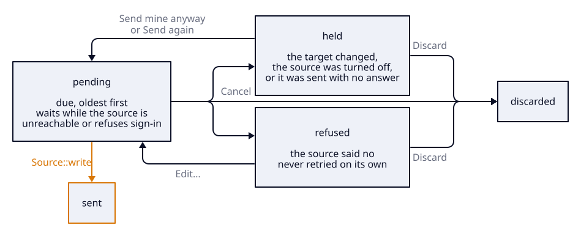
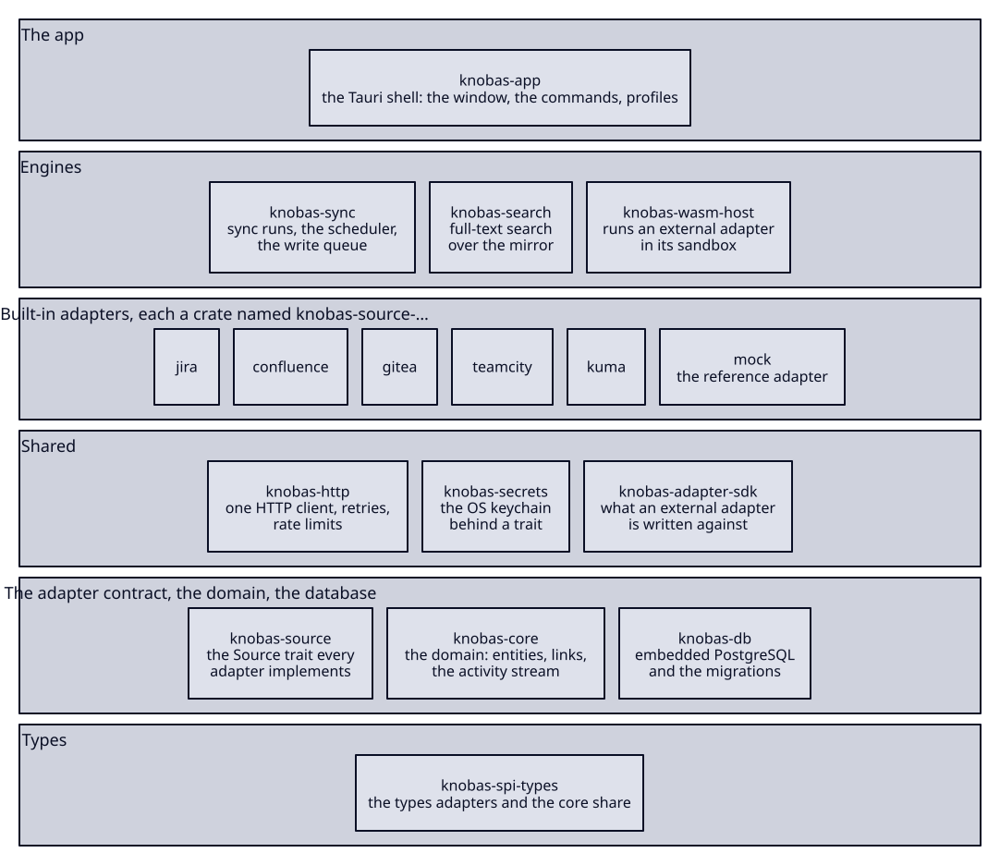

# How knobas works

knobas keeps a copy of your sources in a PostgreSQL database on your own machine. Lists and search read that copy, so they do not wait on a server. Anything you change goes back to its source through one queue.

<picture>
  <source media="(prefers-color-scheme: dark)" srcset="diagrams/system-map-dark.svg">
  
</picture>

Read the picture down the left side for data coming in, and up the right side for changes going out. The amber path is the only route that changes anything at a source.

## Syncing

Each source has an adapter, the code that speaks its API. A sync run asks the adapter what changed since the last run and writes the answer into the mirror, the local copy of every source's items.

- A source syncs every five minutes by default, counted from the end of its previous run. *Sync now* starts a run at once.
- At most five runs go at the same time. Each holds a database connection of its own, so a slow source cannot take one the window needs.
- A failed run backs its source off 1, 2, 5, 15, then 60 minutes.
- A rejected credential stops the retries, because retrying a bad password on a timer can lock the account. Saving a new credential starts them again.
- An item its source deleted keeps its row and is marked as gone, so your links and notes to it survive.

## Reading

Where a page gets its data depends on what it shows.

| You look at | knobas reads |
| --- | --- |
| Lists, boards, the inbox, search | The mirror. No request leaves your machine. |
| A pull request, a build's log and tests | The source, through its adapter. knobas keeps what it read, so the next open draws that at once, says how old it is, and checks the source behind it. |
| A repository's files, the diff between two branches | Your local clone, if it holds the commit. knobas then asks the source and replaces the answer where the two differ. |

Only a read knobas has never made waits on the network. What it keeps of a source's answers sits beside the mirror, is capped at 64 MiB and never goes into a backup. [ADR-0042](adr/0042-a-page-shows-what-knobas-last-read-and-reads-the-source-behind-it.md) and [ADR-0041](adr/0041-knobas-reads-a-branchs-tree-at-its-checkout-and-fetches-its-tip-there.md) have the rules.

## Writing

Everything you change from knobas takes the amber path. That covers comments, status changes, worklogs, merges, re-runs and page edits. knobas stores the write and returns at once. The flush loop sends it afterwards, and it is the only code that calls `Source::write`. `crates/knobas-sync/tests/it/write_choke_point.rs` fails on a second call site.

Before sending, the flush compares the mirror's copy of the target with the snapshot taken when you queued the write. If the target changed since, knobas holds the write and shows you both versions. A held or refused write waits for you. Nothing times out or applies itself.

<picture>
  <source media="(prefers-color-scheme: dark)" srcset="diagrams/write-queue-dark.svg">
  
</picture>

The arrows carry the names of the queue's own buttons. The status bar counts the writes still to send and the ones that need you, and opens the queue.

Delivery is at least once. A write in flight when knobas stops may arrive twice, and knobas sends it again instead of guessing. A write that went out and got no answer is held until you have checked the source, if a second arrival would duplicate it ([ADR-0012](adr/0012-writes-are-at-least-once-no-idempotency-key.md)).

Links, notes, time blocks and link sets are knobas's own. They stay in the local database and never go to a source.

## What surrounds a ticket

The ticket page lists a ticket's code, builds, docs, monitors and assets. No table stores that list. knobas works it out from links each time it is read.

A link joins two items, such as a ticket and its pull request. You draw one with *Link something to it*, and *Start work* draws one from the pull request it makes back to the ticket. From the ticket, knobas follows its links one step, then one more from each item it reached, and stops. So a ticket linked to a pull request also shows that pull request's builds. An asset the walk reaches brings what it holds, the machines it runs on and the monitors that watch it. An epic starts from its child tickets as well ([ADR-0008](adr/0008-context-membership-is-seed-direct-links-one-hop-over-confirmed-links.md)).

A link set adds items without links. It is a named group of repositories, pipelines, pages, assets and monitors, with a rule for the tickets it applies to, such as every ticket under one epic. Editing the set changes every one of those tickets at once ([ADR-0025](adr/0025-link-sets-are-read-beside-membership-never-through-it.md)).

## Credentials

A credential goes into the OS keychain when you save a source. None is written to PostgreSQL, none crosses into the window, and no backup carries one.

## Adapters

Jira and Confluence Data Center, Gitea and Forgejo, TeamCity and Uptime Kuma have built-in adapters.

The app never draws a named source. Each page belongs to a role, one of code host, ticket system, CI, wiki and monitoring, and every source that fills the role appears on it. So an adapter for another code host gets the Code page without knobas knowing its name ([ADR-0029](adr/0029-the-shell-draws-a-role-never-a-source.md)).

Anything else can be an external adapter, a WebAssembly component installed from a GitHub release. It runs under wasmtime with a deadline and a memory cap on every call. It gets no disk and never sees the credential, and it can only reach the hosts its manifest declares. knobas shows you those hosts at install and never updates an adapter on its own.

[`knobas-adapter-sdk`](../crates/knobas-adapter-sdk) is the Rust SDK, and [ADR-0028](adr/0028-an-external-adapter-is-a-sandboxed-wasm-component-installed-from-a-release.md) has the reasoning.

## What is on your disk

- **The database.** One PostgreSQL data directory under the app's data folder, which on macOS is `~/Library/Application Support/dev.knobas.desktop`. knobas downloads PostgreSQL itself once, into `~/.theseus/postgresql`.
- **Clones.** The repositories you clone from knobas, or already have under the clones root you set in Settings.
- **Backups.** A backup holds what only knobas has, your notes included. It leaves the mirror out, because the mirror syncs again.

## How the code is laid out

The backend is a Rust workspace of small crates. A crate depends only on crates in rows below its own.

<picture>
  <source media="(prefers-color-scheme: dark)" srcset="diagrams/crates-dark.svg">
  
</picture>

`knobas-app` is the only crate that knows every adapter. The sync engine, search and the write queue see an adapter only through the `Source` trait in `knobas-source`, which is why an external adapter can stand in for a built-in one. Three more crates exist for tests alone and are left out of the picture.

The window is Svelte 5 on plain Vite, in `app/`, with one folder per page under `app/src/lib/tf/`. [development.md](development.md#crates) has a line on every crate and every frontend folder.

## Where to go next

- [development.md](development.md) covers building, the gate, releases, profiles and what happens at quit.
- [`CONTEXT.md`](../CONTEXT.md) is the vocabulary. Every word in the app and the code means what it says there.
- [`adr/`](adr/) holds the architecture decisions, and [`decisions/`](decisions/) the dated rulings on everything else.
